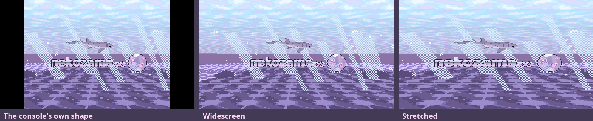
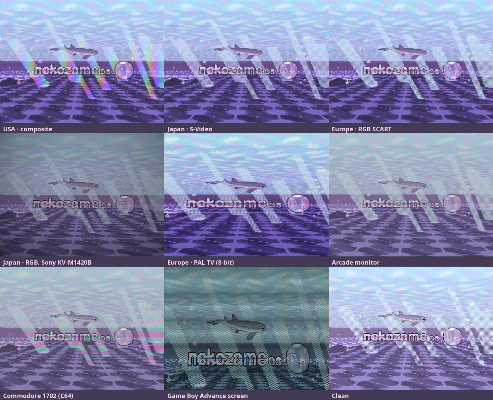

# Emulation on nekozame

Your games with their emulators, art and saves, in Steam and in a frontend.

- The library can be in a folder on the machine (`~/Emulation` by default) or on a network share, like a NAS.
- With a share, every machine plays from the same library, and only the emulators are installed on each one.
- For a NAS, pick "On a network share" in the setup: nekozame connects to it for you, quick with big libraries and after sleep. "In another folder" is for a second drive, or a share you already connect to yourself.
- Saves sync between your machines: start a game on the Deck, keep going on the PC.

| Part | What it does |
|---|---|
| `nekozame-emu` | Installs the emulators, launches games, puts the library in Steam, sets up the frontend |
| `nekozame-saves` | Syncs your saves between machines, through a folder on a share or a WebDAV server; the newest wins and old ones are kept |
| [nekozame-emu-frontend](https://github.com/purplekairi1312/nekozame-emu-frontend) | The frontend for browsing the library: a fork of ES-DE with nekozame's theme |
| Steam | Every game as its own entry with its art, in collections and tabs |

- The quick way: `ujust nekozame-emulation` (also a step of nekozame's first setup) goes through all of it. The sections below explain each step and how to do it by hand.
- On a Steam Deck, the first boot asks where your games are, with the controller: on the Deck, on a NAS (typed with the on-screen keyboard and mounted for good, saves synced there too), or later. Then it sets up the emulators for them and puts every game in Steam once Steam starts. `ujust nekozame-emulation` in Desktop Mode does the rest (video, RetroAchievements, the frontend, covers).

### Without nekozame os

All of it runs on any GNU/Linux. Download this repo with git, and add its commands to your PATH:

```sh
git clone https://github.com/purplekairi1312/nekozame-os.git ~/.local/share/nekozame-os
export PATH="$HOME/.local/share/nekozame-os/system_files/usr/bin:$PATH"
```

- Put the `export` line in your shell's config so it stays.
- Install Python 3 with pygame, Flatpak with Flathub, Steam, mpv (for the music) and gum (for `nekozame-emulation`).
- Then use the commands below as written. Where it says `ujust nekozame-emulation`, run `nekozame-emulation`.
- For ports, install [nekozame-ports](https://github.com/purplekairi1312/nekozame-ports#install) on its own: it's one file.
- To update, run `git pull` in `~/.local/share/nekozame-os`.

---

## 1. Your library

### The layout

The same folder layout ES-DE, EmuDeck and most NAS setups use:

```
Emulation/
├── roms/                    one folder per system: roms/psx, roms/snes, roms/megadrivejp...
├── bios/                    BIOS and firmware files
├── saves/                   one folder per emulator (synced by nekozame-saves)
└── tools/downloaded_media/  art: covers, screenshots... (ES-DE's layout)
```

The folder names are ES-DE's system names. `nekozame-emu systems` lists every system nekozame knows and how many games you have for each.

### File names are the game names

Whatever a file is named is what shows, in Steam and in the frontend. Nothing is renamed to a scraped title unless you ask for it (`"names": "scraped"`, below).

Why:

- A scraper gives every version of a game the same name. With several versions of a game (regions, revisions, translations, hacks), you'd get a list of identical "Sonic the Hedgehog" entries and no way to tell which one you're starting.
- The file names already say which version it is:

```
Sonic the Hedgehog (USA, Europe).md
Sonic the Hedgehog (Japan, Korea).md
Sonic the Hedgehog (USA, Europe) (Rev 1).md
Sonic the Hedgehog (Japan) (Translated En).md
Beat Mania (Japan)/Beat Mania (Japan).m3u
Beatmania (Europe).chd
```

- Scraped names depend on what the database matched, so they can be the wrong game or in another language. File names only change when you change them.

What kind of library it's for:

- Libraries named the way [No-Intro](https://no-intro.org) and [Redump](http://redump.org) (and TOSEC) name their sets: one folder per system, and file names with the game, its region and its version.
- It works best when you keep several versions of games: full sets, different regions, translations, hacks.
- If your files have names like `sonic.bin` or `game1.iso`, use scraped names instead.

What the names do:

- The name shown is the file name without its extension, brackets included. In Steam the name is also printed under each cover (`"labels"`), since covers of different versions often look the same.
- Games with more than one disc go in a folder named after the game, with the discs and an `.m3u` playlist listing them. The playlist shows as the game. A `.cue` and its `.bin` files, or a `.gdi` and its tracks, also show as one game.
- If the same game is there in two formats (a `.chd` and a `.cue`), Steam only gets one, but the frontend shows both, so keep one format per game.
- `nekozame-emu art` gets covers and screenshots from libretro's thumbnail library, which uses No-Intro and Redump names. Files named that way get their art.
- The region is the first bracket that names regions, like `(Japan)` or `(USA, Europe)`. The frontend shows its flags in the corner of the game's data box. `(World)`, `(Asia)`, `(Scandinavia)` and `(Latin America)` don't get a flag.
- Renaming a file makes it a new game in Steam (its entry, art and play time start over) and in the frontend. Rename before adding games to Steam.
- Hidden files (starting with a dot, like the `._` files macOS leaves on network shares) are skipped.

### Scraping

- ES-DE's scraper (Main menu → Scraper) gets art, descriptions, release dates and more from databases like ScreenScraper (a free account helps with its limits).
- nekozame sets it up so scraping fills in everything except the name: "Scrape actual game names" is off.
- The art goes in `media` on the share, so every machine gets it.
- For scraped titles instead: set `"names": "scraped"` in `emulation.json` (Steam then uses the frontend's scraped names where there are some), and turn "Scrape actual game names" back on in the frontend.

### A library on a network share

Skip this with a local library. nekozame reads the library straight from the share; nothing is copied to the machine. Mount it once, for good, with a line in `/etc/fstab`. For an SMB share:

```
//mynas/Emulation  /mnt/mynas/Emulation  cifs  credentials=/etc/nekozame/smb-credentials,iocharset=utf8,actimeo=600,echo_interval=10,uid=1000,gid=1000,_netdev,nofail,x-systemd.automount,x-systemd.mount-timeout=20  0 0
```

And the login, readable only by root:

```sh
sudo mkdir -p /etc/nekozame /mnt/mynas/Emulation
printf 'username=YOU\npassword=YOUR-PASSWORD\n' | sudo tee /etc/nekozame/smb-credentials >/dev/null
sudo chmod 600 /etc/nekozame/smb-credentials
sudo systemctl daemon-reload
```

Keep the password in that file, not in `fstab`: anyone on the machine can read `fstab`.

| Option | Why |
|---|---|
| `actimeo=600` | Remembers each file's details for 10 minutes instead of 1 second. A big library is checked file by file, and over a network every check is a round trip. With it, a 30,000 game library opened in 35 seconds instead of 104. |
| `echo_interval=10` | Notices a dropped connection (after sleep, say) in about 20 seconds instead of up to two minutes. |
| `x-systemd.automount`, `nofail`, `_netdev` | Mounts the share when it's first used, and doesn't hold up booting if the NAS is away. |
| `x-systemd.mount-timeout=20` | Gives up on an unreachable NAS after 20 seconds instead of hanging. |
| No `x-systemd.idle-timeout` | The share shouldn't unmount itself when idle: after sleep, the frontend would freeze waiting for it. |

### Playing away from home

Put the NAS and your machines on [Tailscale](https://tailscale.com) and use the NAS's Tailscale name in `fstab` (`//nas.your-tailnet.ts.net/Emulation`). Then it works the same at home and away. Away from home every file check takes longer, which is why the options above matter.

---

## 2. Settings

The settings are in `~/.config/nekozame/emulation.json`, all of them optional. A local library in `~/Emulation` needs none. For a library on a share:

```json
{
  "roms":  ["/mnt/mynas/Emulation/roms"],
  "bios":  "/mnt/mynas/Emulation/bios",
  "media": ["/mnt/mynas/Emulation/tools/downloaded_media"],
  "steam": {"roms": ["/mnt/mynas/Emulation/roms"], "names": "file"},
  "drawings": "both"
}
```

| Setting | Default | What it does |
|---|---|---|
| `roms` | `["~/Emulation/roms"]` | Where your games are; can be more than one place |
| `bios` | `"~/Emulation/bios"` | BIOS and firmware; the emulators are pointed here |
| `media` | `["~/Emulation/tools/downloaded_media"]` | Art: covers, screenshots, 3D boxes |
| `steam.roms` | Same as `roms` | Whose games go in Steam |
| `steam.names` | `"file"` | Game names: `"file"` (your file names) or `"scraped"` (ES-DE's scraped titles) |
| `steam.labels` | `true` | The name printed under each cover in Steam |
| `loadToRam` | `true` | Disc games (PS1, Saturn, PC Engine CD, PS2, PSP) are read into memory before starting, so reading from the share doesn't interrupt them. Starting takes a bit longer. |
| `gamelists` | `library` | Where the frontend's game lists live: `library`, `local` or `both` (see "Where the game lists live") |
| `video` | console, recommended, no shaders | How games look: `aspect`, `resolution`, `look` (`real`, `clean`, `manual`, `none`), `region` (`eu`, `us`, `jp`) and `shaders` per system (see "How games look") |
| `achievements` | `{"enabled": true, "hardcore": false}` | RetroAchievements, once you've logged in |
| `music` | `true` | The frontend's music |
| `musicVolume` | `40` | Its volume, 0 to 100 |
| `drawings` | `"sharks"` | What's on each frontend page: `"sharks"` (Kawahara Keiga's sharks and rays), `"machines"` (a photo of the console) or `"both"` |
| `ports.minStars` | `25` | How many GitHub stars a new port needs to show up (section 7) |

After changing a setting, run its step again. They're all fine to run as many times as you want.

---

## 3. The emulators

```sh
nekozame-emu setup
```

- Installs the emulators (from Flathub) for the systems you have games for, and points them at your `bios` and `saves`. Run it again after adding a system.
- RetroArch plays most systems. The standalone ones are PCSX2 (PS2), Dolphin (GameCube, Wii), PPSSPP (PSP), RPCS3 (PS3), shadPS4 (PS4), Ryujinx (Switch), Azahar (3DS), Cemu (Wii U), xemu (Xbox) and ScummVM.
- Games launch through `nekozame-emu launch`, which syncs that emulator's saves before and after the game. Launching some other way skips the sync.

### How games look

```sh
nekozame-emu video
```

A menu for this machine's aspect ratio, resolution and shaders. Each machine has its own: the settings file isn't shared, so the Deck and the PC can differ.

- **Shape:** the console's own shape (4:3 for PS1, Saturn, N64, with bars at the sides), widescreen hacks where the emulator has them (PS1, N64, PS2, GameCube), or fill the screen.


- **Resolution:** for the 3D consoles (PS1, N64, PS2, GameCube, Wii, PSP). "Recommended" is picked from this machine's screen and graphics: high enough to fill the screen, but no higher than the machine runs at full speed. On a Steam Deck: PS1 2x, N64 3x, PS2 1x, GameCube 2x, PSP 3x. "Native" is the console's own; a number picks the scale yourself.
- **Shaders:** the real display look (recommended), sharp pixels, a shader chosen per system, or none. The real display look gives each game the display it was most likely played on, per region and platform (a TV, an arcade monitor, a computer monitor, a handheld's own screen), plugged in the way most people did back then. The region comes from the game's name ("(Europe)", "(Japan)"), or its folder (`megadrivejp`, `genesis`), or where you grew up playing, for games and folders sold everywhere. Games from other regions can play on their own region's display (the default) or on yours, as an import would have. "Sharp pixels" has no CRT shader; handhelds keep their screen's grid.

| | USA | Japan | Europe |
|---|---|---|---|
| Atari, ColecoVision, NES, SG-1000, Master System, Spectrum, Apple II | NTSC TV over composite or RF | NTSC TV over composite | PAL TV |
| SNES, Mega Drive, PC Engine, Sega CD, 32X, Neo Geo CD | composite | S-Video (Mega Drive: RGB on a Sony KV-M1420B; PC Engine: composite) | TV over RGB SCART |
| PS1, Saturn, N64, 3DO, Jaguar, PC-FX, Dreamcast | composite | S-Video | TV over RGB SCART |
| MSX | composite | RGB on a Sony KV-M1420B | RGB SCART |

Arcade games get an arcade monitor; the C64 a Commodore 1702 monitor; the Amiga and Amstrad CPC an RGB monitor; PC-88, PC-98 and DOS a sharp monitor; the Vectrex a vector screen; each handheld its own LCD. The NTSC ones match the console's picture width (256 or 320 pixels). On a Steam Deck or built-in graphics, each display has a lighter version.



The picture is nekozame's wallpaper at its own pixels (`art/looks/scene.py`), shown through RetroArch's own shaders by `art/looks/render`; the setup shows it too, in terminals that draw pictures.

RetroArch picks them itself: one per folder, and one per game for games that differ from their folder (or have a folder of their own). They follow the library: a game started from Steam or the frontend gets its own as it starts, and every 6 hours (and after login) the rest are tidied up: presets for games that are gone go, and games started from RetroArch's own menu get theirs (`nekozame-emu video refresh` does it right away).

- **Shaders per system:** each for the systems you choose. They're RetroArch's own, so they cover the systems RetroArch plays (PCSX2, Dolphin and PPSSPP have their own filters). Systems with a CRT shader stay at their native resolution, since that's what CRT shaders are made for. Those cores are switched to OpenGL, which the shaders need.

| Shader | Look |
|---|---|
| `crt-pal` | CRT Royale with a PAL TV's signal: scanlines, the mask, PAL's colour bleed |
| `crt-ntsc` | CRT Royale with an NTSC TV over composite: colour bleed, dot crawl, rainbows |
| `crt-ntsc-svideo` | CRT Royale with an NTSC TV over S-Video, cleaner |
| `crt-royale` | CRT Royale over RGB, the sharpest Royale |
| `crt-pvm` | CRT Royale as a Sony PVM studio monitor (Kurozumi's preset) |
| `crt-guest` | Guest's CRT, many people's default |
| `crt-guest-ntsc` | Guest's CRT with an NTSC composite signal |
| `crt-hyllian`, `crt-easymode`, `crt-lottes`, `crt-geom` | Lighter CRTs: clean scanlines, simple, an arcade monitor, a curved screen |
| `zfast-crt`, `scanlines` | The lightest, for weak machines |
| `sharp` | Pixels kept square and crisp at any size |
| `lcd`, `lcd-gbc`, `lcd-gba`, `lcd-nds` | A handheld screen's pixel grid, with that screen's colours |
| `gameboy` | The original Game Boy's green dot matrix |

The Royale ones are heavy, but a Steam Deck runs them at the consoles' native resolution.

"Suggested" sets what the emulation community most often uses for each system: Guest's CRT for the 8 and 16-bit consoles, Royale NTSC for PS1, Saturn, N64, 3DO and Jaguar, CRT Lottes for arcade games, and each handheld's own screen.

Without the menu: `nekozame-emu video look real` (or `clean`, `manual`, `none`), `nekozame-emu video region eu` (or `us`, `jp`), `nekozame-emu video imports home` (or `own`), `nekozame-emu video aspect wide`, `nekozame-emu video resolution 4`, `nekozame-emu video shader crt-pal psx saturn n64`, `nekozame-emu video shader suggested`, `nekozame-emu video shader off`. `nekozame-emu video shaders` lists them.

### RetroAchievements

```sh
nekozame-emu achievements login
```

Achievements from [RetroAchievements](https://retroachievements.org) in RetroArch, PCSX2, Dolphin and PPSSPP.

- You log in once per machine. Only the login token RetroAchievements gives back is kept, never your password, in a file only you can read.
- RetroAchievements recognizes a game by its file, matched against the No-Intro and Redump dumps, so games named and dumped that way get their achievements. Most hacks and translations don't have any.
- `nekozame-emu achievements hardcore on` turns on hardcore mode: no save states, rewind, slow motion or cheats, as RetroAchievements needs for hardcore points. `off` goes back to normal.
- `nekozame-emu achievements off` turns them off in every emulator, keeping the login. `logout` takes the login off this machine.
- If you already logged in inside an emulator, nekozame leaves that login alone until you log in with `nekozame-emu achievements login`.

---

## 4. Saves

```sh
nekozame-saves setup
```

Pick where your saves live: a folder on the share (`/mnt/mynas/Emulation/saves`) or a WebDAV server. Every machine syncs with that one place.

- How a save wins: nekozame remembers each save as it was at the last sync. Changed on one side only, that side's copy goes to the other. Changed on both (you played on two machines in between), the newest wins, the other is kept, and you're told.
- Nothing is thrown away: before a save is replaced, on either side, the old one goes into its history (the last 20). `nekozame-saves history PATH` lists them, `nekozame-saves restore PATH VERSION` puts one back.
- Deleting a save on one machine doesn't delete it elsewhere; the next sync brings it back.
- RetroArch has its own cloud sync, which can use a WebDAV server on the NAS (Settings → Saving → Cloud Sync). When it's on, nekozame leaves RetroArch's saves to it and uses the same server and login for the other emulators' saves, in a folder of its own.
- `nekozame-saves status` shows where saves go and what the next sync would change.

---

## 5. Steam

```sh
nekozame-emu steam add
```

Puts every game in Steam as its own entry, with its art and launch command. With a big library it takes a while. Run it again after adding games; only the new ones are added.

- Collections: one per system (PlayStation, Mega Drive...) and one called Emulation with all the games.
- Tabs: with Decky's TabMaster plugin (`ujust nekozame-decky` installs it), `nekozame-emu steam tabs` sets up Apps (your other non-Steam apps, like Heroic or Tauon), Emulation (the games and emulators) and Ports (section 7). Steam's own non-Steam tab is hidden. Restart Decky (or the machine) to see them.
- Steam forgets big collections when it restarts, because its cloud won't store thousands of games in one. The `nekozame-emu-collections` service puts them back a few seconds after Steam starts, and removes stray copies of games. It's on by default.
- `nekozame-emu steam refresh` redoes the art and collections. `nekozame-emu steam remove` takes all the games out of Steam.
- Games without a cover: `nekozame-emu art` gets covers and screenshots from libretro's thumbnail library, matched by your file names.
- 3D boxes: the frontend's scraper brings ScreenScraper's own (Scraper → Content settings → 3D boxes), which look best. For games without one, `nekozame-emu boxes` makes them from each game's cover. With `"autoBoxes": true` in `emulation.json` they're also made on their own, after `nekozame-emu art` and for new covers within 10 minutes (the `nekozame-emu-collections` service looks for them). The case follows the system (cardboard for NES or SNES, a clamshell for the Mega Drive, a jewel case for PS1 or Saturn, a keep case in the console's color for PS2, GameCube, Wii or Switch). Scraped boxes stay as they are. `nekozame-emu boxes psx saturn` does only those systems; `--again` redoes the ones nekozame made.

---

## 6. The frontend

```sh
nekozame-emu esde on
```

Installs [nekozame-emu-frontend](https://github.com/purplekairi1312/nekozame-emu-frontend), the fork of ES-DE, for browsing the whole library (Steam gets slow with tens of thousands of entries). It shows up in Steam's Apps tab. `nekozame-emu esde off` removes it; your game lists and art stay.

What it sets up:

- Systems by maker and year, each console's regional versions together in the order they came out, with the region next to the name. Under Sega: Mega Drive | Japan (1988), Genesis | North America (1989), Mega Drive | Europe (1990), then the Game Gear, then the Mega-CD family.
- Your file names as the game names, also after scraping.
- nekozame's launcher as each system's first emulator, so saves sync. ES-DE's other emulators are still available per game.
- The nekozame theme: each system is a page in the style of an ocean-themed 90s Japanese magazine, printed on your machine from public-domain photos and your games' screenshots by the frontend's own printer (`nekozame-theme`, with pygame; without pygame the theme comes without its pages). Each page has a text about the console in English or Japanese (UI Settings → Theme language).
- Color schemes (UI Settings → Color scheme): nekozame, lilac, sakura, ocean, sunset.
- Layouts (UI Settings → Theme variant): game list, cover grid, review page, filmstrip, contents, each with screenshot, title screen, cover, 3D box, disc or cartridge, or video.
- The drawings on top, set with `"drawings"`.
- Menu colors: nekozame and nekozame light (UI Settings → Menu color scheme).
- Music: "dolphin sanctuary" by [purplekairi1312](https://passedrecordings.bandcamp.com/track/dolphin-sanctuary), an ocean-themed ambient track released by [Passed Recordings](https://passedrecordings.co.uk/) on [Passed Oceans](https://passedrecordings.bandcamp.com/album/passed-oceans), plays while you browse and pauses during games and the screensaver. `"music": false` turns it off. Buy it on [Bandcamp](https://passedrecordings.bandcamp.com/track/dolphin-sanctuary) or [Ampwall](https://ampwall.com/a/passedrecordings/album/passed-oceans), or listen on [YouTube](https://www.youtube.com/watch?v=-QDAa7hzcGU&t=7730s). © 2026 purplekairi1312, all rights reserved; it isn't under nekozame os's license, and comes with the frontend (see [its license](https://github.com/purplekairi1312/nekozame-emu-frontend/blob/main/nekozame/music/LICENSE)).
- The screensaver is a slideshow of screenshots, since the video one can freeze the frontend on a network share.

After adding games or changing `"drawings"`, print the pages again:

```sh
nekozame-emu esde on --again
```

### Where the game lists live

The frontend keeps what it scrapes (descriptions, dates, genres...), your favourites and play counts in game lists, one per system. By default they live with the library, wherever it is: in `tools/gamelists` next to the art, on a share, a disk, or in `~/Emulation`. Every machine that uses the library sees what one scrapes.

`nekozame-emu esde gamelists` changes it, with a menu, or by name (`nekozame-emu esde gamelists local`):

| Setting | Where | Good for |
|---|---|---|
| `library` | With the library, in `tools/gamelists` next to the art | Most setups. The default |
| `local` | This machine only (`~/ES-DE/gamelists`) | Keeping a machine's lists, favourites and play counts to itself |
| `both` | This machine's own copy, synced with the library's when the frontend opens and closes | A machine with some games of its own that's sometimes away from the library |

- Switching never loses anything. Moving to the library adds this machine's lists to the library's, keeping the newer of each, and sets this machine's aside in `~/ES-DE`.
- With `both`, the newer list of a system wins, and the one it replaces is kept next to it as `gamelist.xml.bak`.
- `both` only helps when the machine has games of its own: the frontend only lists games it can reach. With a library on a share and two machines using the frontend at once, whichever closes last wins for a system both changed.

To bring in game lists from elsewhere (an old ES-DE or EmuDeck, a backup, another machine's):

```sh
nekozame-emu esde gamelists import FOLDER
```

- It finds the lists in ES-DE's layout (`SYSTEM/gamelist.xml`) or the old one inside the ROM folders (`roms/SYSTEM/gamelist.xml`).
- It merges them game by game: games you don't have info for are added, and games you do only get what's missing filled in. Your own info, favourites and play counts stay.
- Each list it changes is kept as `gamelist.xml.bak` first.

More on how the frontend works: its [guide](https://github.com/purplekairi1312/nekozame-emu-frontend/blob/main/docs/guide.md).

---

## 7. Ports, decomps and recomps

Games rebuilt by fans to run natively, without an emulator: decompiled (Ship of Harkinian for Ocarina of Time), recompiled (Zelda 64: Recompiled, Unleashed Recompiled), or with their engine rewritten (GZDoom, OpenMW, DevilutionX).

```sh
ujust nekozame-ports
```

Shows them, the newest first, and installs the ones you pick. They go in Steam's Ports tab and the frontend's Ports system.

- It's [nekozame-ports](https://github.com/purplekairi1312/nekozame-ports), which has its own repo so it works on any GNU/Linux.
- The ports come from a [reviewed catalog](https://github.com/purplekairi1312/nekozame-ports/blob/main/docs/catalog.md): each one was looked at before it was added.
- Flathub's sandboxed version is used whenever a port is there. The others come from the project's own GitHub releases and run unsandboxed, like any program you download.
- Most ports need your own copy of the game (a ROM, or the game's files). `nekozame-ports info NAME` says what, and the port's first start says it again.
- It checks for new ports in the catalog every week and tells you. `nekozame-ports check` looks right away.
- `nekozame-ports update` updates the installed ones, `nekozame-ports remove NAME` uninstalls one, `nekozame-ports list` shows the whole catalog.
- More: its [guide](https://github.com/purplekairi1312/nekozame-ports/blob/main/docs/guide.md).

---

## 8. When something's wrong

| What you see | Why, and what to do |
|---|---|
| The frontend takes minutes to open | It checks every game on the share when it starts. Check the mount has `actimeo=600` (section 1). A library of about 30,000 games opens in around 35 seconds. |
| The frontend froze after the machine slept | The share was still reconnecting. With `echo_interval=10` and no idle timeout (section 1), it comes back in about 20 seconds. |
| A black square on a dark screen in Game Mode, after pressing the power button | Steam is stuck on its "app running" screen in front of the game. Restart Steam (or the machine). |
| The Apps tab is full of games | Steam forgot the Emulation collection when it restarted. Check `systemctl --user status nekozame-emu-collections`: it should be running, and it puts the collection back after each Steam start. |
| The screensaver freezes the frontend | It's set to video. Pick the slideshow (UI Settings → Screensaver settings). `nekozame-emu esde on` sets it. |
| A game stalls for a moment while playing | It's reading its disc over the network. Check `"loadToRam"` is on and run `nekozame-emu setup` again. |
| A save is missing or old | `nekozame-saves status`, then `nekozame-saves history PATH`: older versions are kept. |

---

## Credits

- The frontend's photos are from NOAA (public domain).
- The sharks and rays were painted by Kawahara Keiga (川原慶賀) for Philipp Franz von Siebold in the 1820s; the scans are from the Naturalis Biodiversity Center (public domain).
- The photos of the consoles are by Evan-Amos (public domain, a few CC BY-SA).
- They're the frontend's, with its theme: each file's source and license is in [its credits](https://github.com/purplekairi1312/nekozame-emu-frontend/blob/main/docs/credits.md).
